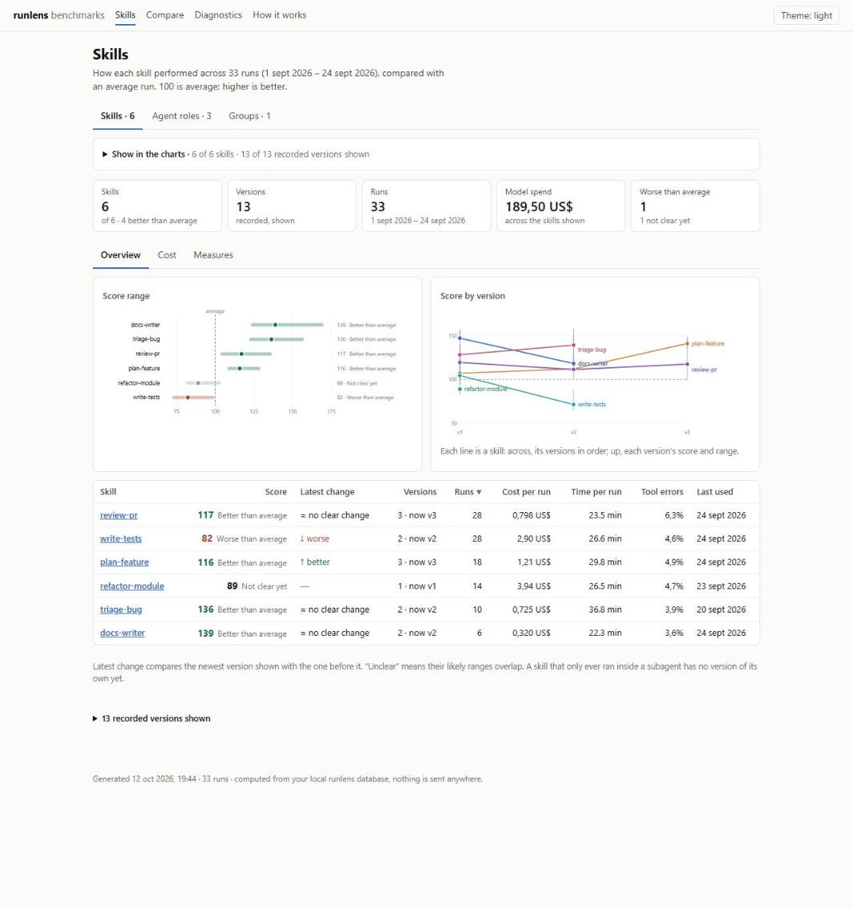
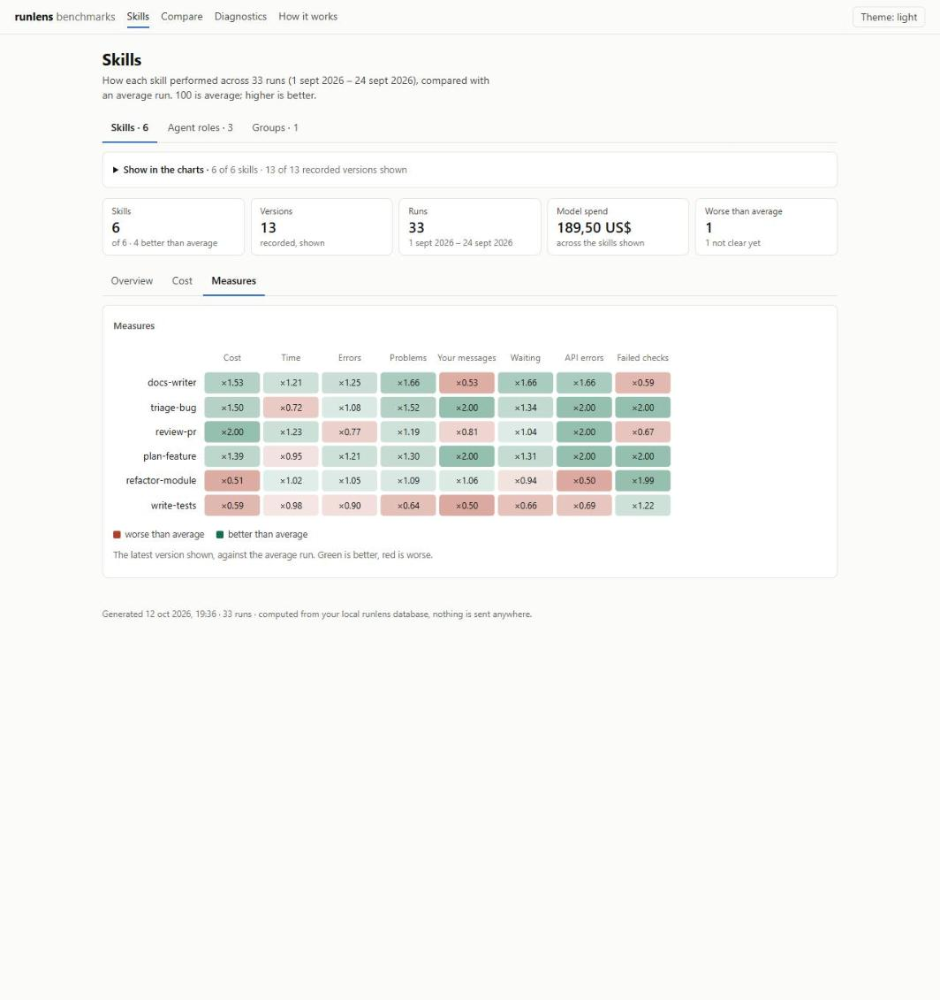
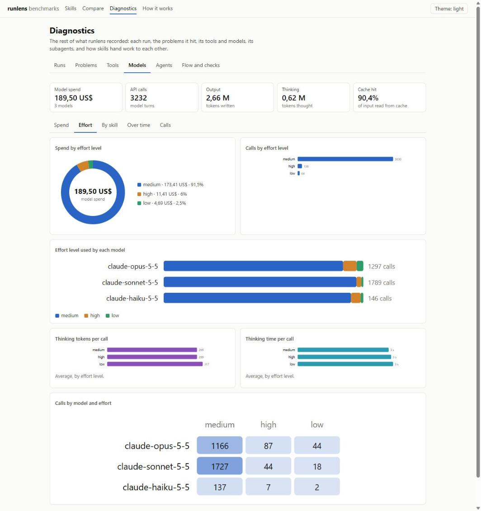
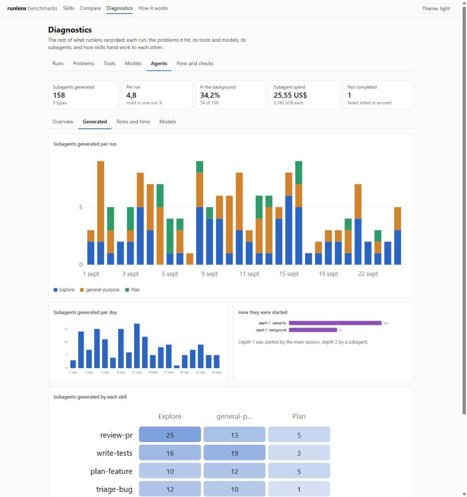
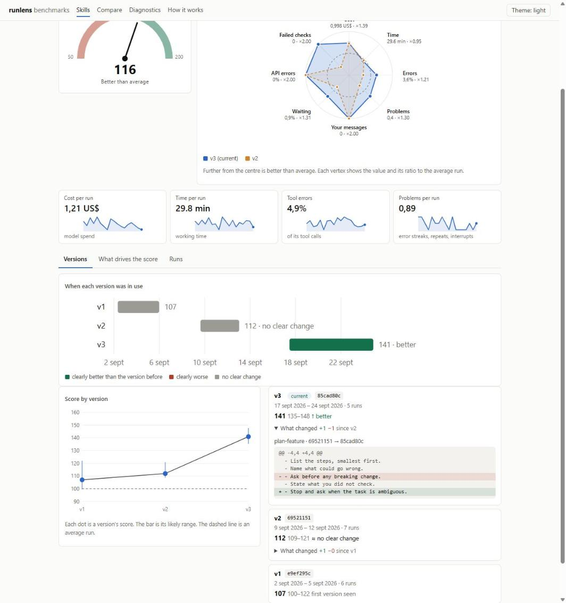

# runlens

**Benchmarks for your Claude Code skills and agents, built from your own run history.**

runlens archives every Claude Code session (and the subagents it spawned) into a local DuckDB database, then scores each skill, agent role and group of skills against your average run. It tells you where a flow struggles, what it costs, and whether the last edit to a skill made things better or worse. Everything stays on your machine, and the dashboard is one static HTML file.

<p align="center">
  <picture>
    <source media="(prefers-color-scheme: dark)" srcset="docs/images/skills-dark.jpg">
    
  </picture>
</p>
<p align="center"><sub>The dashboard, in the theme your system uses. All the screenshots in this README come from invented data (see <a href="#screenshots">Screenshots</a>).</sub></p>

- **A score per skill, computed and not labelled by hand.** A weighted geometric mean of eight measures (cost, time, errors, incidents, your interruptions and more), each against the average run, with a likely range so you can tell a real change from noise.
- **Versions.** Each distinct text of a skill is a version, with the diff from the one before and a verdict on whether the score really moved.
- **Charts and tables for the rest.** Models, effort, subagents, tools, incidents and how skills hand work to each other.
- **A retrospective skill**, `/runlens-retro`, that turns the evidence into proposed skill edits.

A **run** is one Claude Code session plus every subagent it spawned. runlens knows nothing about any skill or flow: skills, agent types and roles are attributes read from the transcripts. Everything specific to a flow lives in `~/.runlens/config.toml`:
- which sessions count as runs;
- which output lines are signals;
- which files outside the transcript to keep.

## Quick start

```bash
uv tool install git+https://github.com/marcossp32/runlens.git
runlens install      # the hook, the /runlens-retro skill and a starter config
runlens refresh      # load the runs you already have
runlens dashboard    # prints the path of dashboard.html: open it in a browser
```

[Install](#install) explains each step. What you get:

- **A database of your runs**, in DuckDB: every model call, tool call, subagent, incident and skill version.
- **A dashboard**: a score for every skill and agent role, how each version of a skill compared with the one before, and diagnostics for the rest.
- **A retrospective skill**, `/runlens-retro`, that turns the evidence into proposed skill edits.

## Requirements

| What | Why |
|---|---|
| [uv](https://docs.astral.sh/uv/getting-started/installation/) | Installs runlens and the Python it runs on. You don't need Python installed yourself: uv fetches Python 3.11+ if it is missing |
| [Claude Code](https://code.claude.com/docs/en/setup) | runlens reads the transcripts Claude Code writes to `~/.claude/projects` |
| `claude` on the PATH | Only for `runlens classify`, which runs `claude -p` with your Claude Code login |
| git | Only if your config archives files with `{git_dir}` |

Works on Windows, macOS and Linux.

## Install

Do this on every machine where you run Claude Code.

**1. Install the tool.**

```bash
uv tool install git+https://github.com/marcossp32/runlens.git
```

This puts `runlens` in uv's tool directory, in its own environment. If `runlens` is not found afterwards, run `uv tool update-shell` and open a new terminal.

**2. Hook it into Claude Code.**

```bash
runlens install
```

This does three things, and is safe to run again:
- adds an async `SessionEnd` hook to `~/.claude/settings.json`, after backing the file up to `settings.json.runlens-backup-<time>`;
- copies the `/runlens-retro` skill into `~/.claude/skills`;
- writes `~/.runlens/config.toml` from [`config.example.toml`](runlens/config.example.toml) if there is none.

**3. Tell it which runs to record.**

Edit `[select]` in `~/.runlens/config.toml`. With the defaults, every session is recorded. For mstack's `/m-feature` flow, use the example config instead:

```bash
curl -o ~/.runlens/config.toml https://raw.githubusercontent.com/marcossp32/runlens/main/examples/m-feature.toml
```

**4. Load what you already have.**

```bash
runlens refresh
runlens check
```

From then on, the hook archives and ingests each run in the background when its session ends. Activity is logged to `~/.runlens/hooks.log`.

**5. Optional: keep Claude Code's own transcripts longer.**

Claude Code deletes transcripts after `cleanupPeriodDays`, 30 by default. The runlens archive keeps its own copy, so this only matters if you want older sessions in `/resume` or want `runlens refresh` to reach further back. Set it in `~/.claude/settings.json`:

```json
{ "cleanupPeriodDays": 90 }
```

### Good to know

- **Data stays on the machine.** The archive, the database and the report live in `~/.runlens/`, outside the repo. Each machine records only its own sessions. To bring another machine's history over, copy its `~/.runlens/archive/` and run `runlens ingest`.
- **The hook calls the tool's own Python** by absolute path. `uv tool upgrade` keeps that path. After `uv tool uninstall` followed by a fresh install, run `runlens install` again.
- **The dashboard contains transcript text.** It embeds the text of each skill version and the arguments of each run, so it is as private as the transcripts. Keep it on your machine, and check it before you share it.

### Update

```bash
uv tool upgrade runlens
runlens install     # refreshes the /runlens-retro skill
runlens refresh     # once: records the skill texts that versions are diffed against
```

### Uninstall

```bash
runlens uninstall                  # removes the hook from ~/.claude/settings.json
uv tool uninstall runlens
rm -rf ~/.claude/skills/runlens-retro
rm -rf ~/.runlens                  # only if you also want to delete the recorded history
```

## Use

```bash
runlens refresh      # archive + ingest the runs selected in config.toml
runlens check        # compare the database with the raw transcripts
runlens report       # write ~/.runlens/report.html
runlens dashboard    # write ~/.runlens/dashboard.html: scores, versions, profiles, comparisons
runlens show <id>    # the timeline around an incident or a tool call
```

| Command | What it does |
|---|---|
| `archive`, `ingest`, `refresh` | Copy runs out of `~/.claude/projects` and load them into DuckDB. Idempotent. Filters: `--since`, `--skill`, `--project`, `--session` |
| `check` | Compares counts with the raw transcripts, checks cost against Claude Code's `cost-state`, and finds subagents with no parent. The transcript format is internal to Claude Code and changes between versions; a `FAIL` means the parser fell behind |
| `summary` | One table per run and one per skill, in the terminal |
| `report` | A self-contained HTML report. `--session` limits it to some runs |
| `dashboard` | The benchmark dashboard, one static HTML file (see [Dashboard and benchmarks](#dashboard-and-benchmarks)). `--out` chooses the path. Rebuilt after each ingested run unless `[dashboard] auto = false` |
| `incidents` | List incidents (`--type`, `--skill`) |
| `show <id>` | What the agent was asked, said and did, in order, around an incident or a tool call |
| `classify` | Labels incidents with a failure taxonomy through `claude -p`. Uses your Claude Code login, no API key. About $0.02 per incident on Sonnet |
| `labels export/import <csv>` | Human review of the labels |
| `agreement` | LLM against human labels: Cohen's kappa, and TPR/TNR per category |
| `sql "<query>"` | Any query over the tables and views |

In Claude Code, `/runlens-retro` runs the whole retrospective:
1. refresh and check;
2. label;
3. read the traces behind the worst failure modes;
4. propose skill edits, each with its evidence and the metric that should move.

## What it records

| Table | One row per |
|---|---|
| `runs` | run: repo, branch, Claude Code version, cost, active time, human prompts |
| `agents` | agent (`main` and each subagent): type, role, spawn prompt, parent, final status, tokens, peak context, cost |
| `api_calls` | API call: model, effort, skill, tokens, cost |
| `tool_calls` | tool call: tool, skill, input, duration, error and its class, denial, idle wait, test file touched |
| `texts` | the agent's visible text between tool calls (the "why") |
| `events` | human prompts, interrupts, compactions, API errors, turn durations |
| `markers` | matches of the patterns in `config.toml` |
| `skill_loads` | each skill load, with a hash of the skill text (its version) and the invocation arguments |
| `skill_texts` | each skill version's text, once per skill and hash: what a diff between versions compares |
| `incidents` | moments worth reading, each with the timeline that led to it |
| `labels` | failure labels from the LLM and from humans; they survive re-ingest |

The `v_*` views in [`views.sql`](runlens/views.sql) group by run, skill, agent role, model, tool, error class, incident, label and skill version.

## How the data is read

- **Cost.** Each model's cost comes from Claude Code's `cost-state` and is split across that model's calls by their list-price cost. A run that is still open has no `cost-state` yet, so it is estimated at list price (`runs.cost_estimated`). Override prices under `[prices]`.
- **Skill attribution.** Each model turn and tool call is credited to a skill:
  - a skill load pushes it onto the stack of its agent;
  - an explicit `attributionSkill` wins;
  - a change to `None` pops back to the outer skill, because Claude Code records `None` when a nested skill ends; the outermost skill is never popped;
  - a subagent turn with no attribution inherits the skill active where the subagent was spawned.
  - **Known gap.** Claude Code also writes the spawning skill as `attributionSkill` on subagent turns. So a skill that a subagent loads for itself is credited to the skill that spawned it, and it gets no unit or versions of its own. Changing that would change every per-skill total, so those skills are listed instead on the Diagnostics page, under Agents, **Skills inside**.
- **Forks.** A fork agent starts with a copy of its parent's history. Those records are skipped, so no work is counted twice.
- **Roles.** A role is the subagent's description with numbers folded, so `Repro F-013` becomes `Repro F-#`.
- **Skill versions.** A version is a hash of the skill text as Claude Code injected it, without the invocation arguments. Each version's text is kept once in `skill_texts`, so the dashboard can diff versions. `v_skill_version_stats` compares versions in SQL. A version whose text was never recorded is shown as unrecorded, and it is not counted as a version.
- **Incidents.** The generic ones are:
  - `error_streak`: consecutive failing tool calls;
  - `repeated_call`: identical calls;
  - `idle_loop`: calls that only wait or print, including `until …; do sleep` loops;
  - `test_edit_after_failure`: an edit to a test file right after a failure, a possible sign of test tampering;
  - `agent_failed`;
  - `permission_denied`;
  - `interrupt`;
  - `compaction`;
  - `api_error`;
  - `bad_marker`: a config marker whose value is declared bad.
- **Taxonomy.** Seeded from MAST and from coding-agent failure studies, plus operational categories. To adapt it, copy [`taxonomy.toml`](runlens/taxonomy.toml) to `~/.runlens/taxonomy.toml`.
- **LLM labels.** They are a first pass, not ground truth: unvalidated judges find few errors in traces. Review a sample with `labels export/import` and read `agreement` before trusting a category.

## Dashboard and benchmarks

`runlens dashboard` writes `~/.runlens/dashboard.html`: one static page with the data embedded. It opens offline from any folder, needs no server, and makes no network requests. The hook rebuilds it after each run is ingested.

Every skill that ran and every agent role gets its own score, with no labelling by hand. Each group you define in `config.toml` gets one too.

### The pages

<p align="center"></p>

| Page | It answers | What is on it |
|---|---|---|
| **Skills** | Which skills do well, and did a new version help? | Summary cards, the score range of every skill, score by version, score against cost, a treemap of spend, a heatmap of every measure, runs per day, and a sortable table. Agent roles and groups are on the other two tabs |
| **A skill, role or group** | Why is this score what it is? | A gauge, a radar profile against the average, and trends. Tabs: **Versions** (when each was in use, its score, what changed, with the diff), **What drives the score** (spend by version and every measure), **Runs** (cost over time, cost against time, each run) |
| **Compare** | Is version B really better than A? | Any two skills, roles or groups, and any of their versions: a verdict from their likely ranges, a radar overlay, and bars for each measure |
| **Diagnostics** | What else happened? | Six tabs, below |
| **How it works** | How is the score made? | Five short tabs, including a worked example that walks one of your own skills from its measures to its score |

The Skills page has three tabs of charts: Overview, Cost and Measures.

<p align="center"></p>
<p align="center"></p>

### Choosing what the charts show

On the Skills page, the **Show in the charts** panel is collapsed, with the current counts on its summary line.

- Tick a skill to show it, or one of its versions to show that version. The buttons turn on all skills, no skills, all versions, or only the latest version of each skill.
- Tick **Show each version as its own item in every chart** and every plot, the heatmap and the table draw each version as a separate entry.
- Every chart and table on the page follows the choice, and it is remembered in the browser.
- A skill with some versions left out is scored from the versions still on. That score is a single number with no range.
- Agent roles seen only once are hidden until you tick the box on their tab.

### Diagnostics

<p align="center"></p>
<p align="center"></p>

- **Runs**: cost, active time, lines changed, prompts and incidents per run, with scatter plots of cost against time and against code changed.
- **Problems**: incidents by type, role and skill, and tool errors by class and tool.
- **Tools**: calls, error rate, latency, and where the time goes.
- **Models**: spend; effort (spend and calls by level, thinking tokens and time, which model ran at which level); spend by skill and model; spend and calls per day; API errors, tokens processed and cache hit.
- **Agents**: overview (spend, context size, how subagents ended); generated (how many each run, day and skill started, by type, and whether they ran in the background); roles and time; which models they used; the skills they loaded for themselves.
- **Flow and checks**: which skill hands over to which, your config's markers, and failure labels once `runlens classify` has run.

### The score

100 is the average run of the same kind (skill, agent role or group). Above 100 is better. It combines eight measures, each compared with that average and weighted:

| Measure | Weight | What it is |
|---|---|---|
| Cost per run | 3 | model spend attributed to the unit |
| Time per run | 2 | working time: from each model turn to the same agent's next, capped at 10 minutes |
| Tool error rate | 2 | failing tool calls over all its tool calls |
| Incidents per run | 2 | error streaks, repeated calls, interrupts and the other incident types |
| Human prompts per run | 2 | your messages while the unit was the active skill (skills and groups only) |
| Idle call rate | 1 | tool calls that only wait or print |
| API error rate | 1 | API errors over model turns |
| Bad markers per run | 1 | config markers whose value is declared bad |

A unit with few runs is pulled toward the average, and no measure counts for more than a factor of two either way. The page "How it works" has the exact formula.

**The likely range** is the 5th to 95th percentile of the score over 200 resamples of the unit's runs. A unit is called better or worse than average only when its whole range is on one side of 100, and two scores are only called different when their ranges do not overlap. Units with fewer than five runs are flagged.

### Versions

A version is one distinct skill text, recorded when Claude Code loads the skill. Versions are numbered by first use, and each is diffed against the one before it. Only versions whose text was recorded are counted: a skill with no recorded text shows as unrecorded.

<p align="center"></p>

**Compare** puts any two versions (or skills, roles, groups) side by side and says whether their ranges overlap:

<p align="center"></p>

### Groups

Name a set of skills and agent types in `config.toml`:

```toml
[[group]]
name = "my-flow"
members = ["skill:my-plan", "skill:my-build", "agent:Explore"]
```

A group's runs are the union of its members' work, each piece counted once. Its version is the combination of its members' versions, so it changes when any member's text changes.

The dashboard's own **How it works** page walks one skill from its measures to its score:

<p align="center"></p>

### What the score does not tell you

- **Whether a run produced the right result.** It measures cost, time, failures and how often you had to step in. Read the traces with `runlens show` before acting on a drop.
- **Anything about a skill that only ran inside a subagent.** It has no score of its own; it is listed under Diagnostics, Agents, **Skills inside**. See [How the data is read](#how-the-data-is-read).
- **More than the runs support.** With few runs the range is wide; trust the range, not the number.

## Using it with your flow

Only `config.toml` changes. See [`config.example.toml`](runlens/config.example.toml) for every option, and [`examples/m-feature.toml`](examples/m-feature.toml) for a real config for [mstack](https://github.com/marcossp32/mstack)'s `/m-feature` flow.

| Section | What it sets | Default |
|---|---|---|
| `[select]` | which sessions are runs: `since`, `skills`, `projects` | every session |
| `[[evidence]]` | extra files to archive with each run | none |
| `[[marker]]` | output lines that are signals, and which values are bad | none |
| `[[group]]` | a set of skills and agent types to score together | none |
| `[dashboard]` | `auto`: rebuild the dashboard after each ingested run | `true` |
| `[analysis]` | thresholds of the generic incident detectors | see the example |
| `[classify]` | the model `runlens classify` uses | `sonnet` |
| `[prices]` | per-model prices, for models missing from the built-in table | built in |

## Troubleshooting

| You see | Why, and what to do |
|---|---|
| A diff says "text not recorded yet" | The skill text is recorded when a run is ingested. Run `runlens refresh` once |
| A skill is not on the dashboard | It may not match `[select]`, or it only ever ran inside a subagent (see Diagnostics, Agents, Skills inside) |
| Charts are empty or missing a skill | Open **Show in the charts** on the Skills page and tick it, or press **All skills** |
| "few runs" next to a score | The unit has fewer than five runs. Read its range, not the number |
| The dashboard is out of date | It is rebuilt by the hook when a session ends. Run `runlens dashboard` to rebuild it now. A failure is logged in `~/.runlens/hooks.log` |
| `runlens check` reports `FAIL` | The transcript format changed and the parser fell behind. Do not trust the numbers until it passes |

## Development

```bash
git clone git@github.com:marcossp32/runlens.git
cd runlens
uv sync                                         # .venv with the locked dependencies
uv run python -m unittest discover -s tests -v
uv tool install -e .                            # a `runlens` command that runs this checkout
```

Dependencies are locked in `uv.lock`. After changing them in `pyproject.toml`, run `uv lock`.

CI runs the tests on Windows and Linux with Python 3.11 and 3.14. They use a synthetic run that covers every tricky part of the transcript format:
- messages split across records;
- forks with copied history;
- skills with no attribution;
- cost allocation;
- markers and incidents;
- the hook, install, labels and dashboard.

`tests/test_bench.py` checks the score, the version, group and attribution rules on plain rows, without a database.

### Screenshots

The images in this README come from `scripts/make_demo.py`, which builds an invented history (six made-up skills, three models, 33 runs) in a throwaway home folder. It never reads your transcripts. To see the same data:

```bash
python scripts/make_demo.py demo-home
RUNLENS_HOME=demo-home runlens dashboard --out demo.html
```

## References

- Cemri et al., [Why Do Multi-Agent LLM Systems Fail?](https://arxiv.org/abs/2503.13657) (MAST), NeurIPS 2025: the failure taxonomy seed.
- [SWE-PRM](https://arxiv.org/abs/2509.02360) and [ImpossibleBench](https://arxiv.org/abs/2510.20270): coding-agent failure modes and test tampering.
- [TRAIL](https://arxiv.org/abs/2505.08638): why trace judges must be validated.
- Hamel Husain and Shreya Shankar, [LLM Evals FAQ](https://hamel.dev/blog/posts/evals-faq/): error analysis, binary judges, judge alignment.
- Anthropic, [Demystifying evals for AI agents](https://www.anthropic.com/engineering/demystifying-evals-for-ai-agents).
- Claude Code [monitoring](https://code.claude.com/docs/en/monitoring-usage) and [hooks](https://code.claude.com/docs/en/hooks) docs.

## License

[MIT](LICENSE)
