<h1 align="center">runlens</h1>

<p align="center">
  <strong>Find what fails in your real Claude Code runs, per skill and per version,<br>and check whether your last edit helped.</strong>
</p>

<p align="center">
  <a href="https://github.com/marcossp32/runlens/actions/workflows/ci.yml"></a>
  
  
  
  <a href="LICENSE"></a>
</p>

<p align="center">
  <a href="#quick-start">Quick start</a> ·
  <a href="#a-tour-of-the-dashboard">Tour</a> ·
  <a href="#improve-a-skill-step-by-step">Improve a skill</a> ·
  <a href="#the-method">The method</a> ·
  <a href="#cli-reference">CLI</a> ·
  <a href="#config-reference">Config</a> ·
  <a href="#troubleshooting">Troubleshooting</a>
</p>

<p align="center">
  <picture>
    <source media="(prefers-color-scheme: dark)" srcset="docs/images/overview-dark.jpg">
    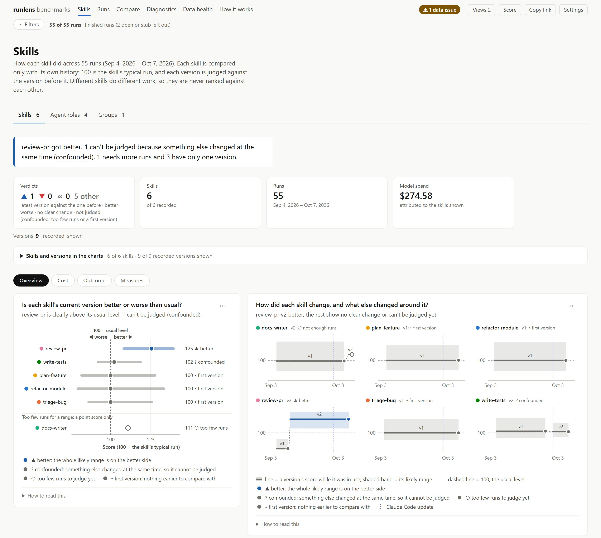
  </picture>
  <br>
  <sub>All screenshots use invented demo data (<a href="#screenshots">how to make them</a>).</sub>
</p>

runlens archives every Claude Code session, and the subagents it spawned, into a local DuckDB database. It credits cost, time, tool errors, problems and your interruptions to the skill that was active, keeps every version of each skill's text, and tells you whether a new version's runs look **better, worse or show no clear change** compared with the version before. Everything stays on your machine; the dashboard is one static HTML file.

## Why runlens

- **It reads the runs you already did.** No instrumentation, no SDK and no API key: a `SessionEnd` hook archives each session as it ends.
- **It judges each skill against its own history.** Research is cheaper than building, and that says nothing about either. Versions are compared only within the same skill, with an interval, and skills are never ranked against each other.
- **It is honest about what it can't tell.** Too few runs gives `not enough runs`. If another skill, the model or Claude Code changed at the same time, the verdict is `confounded` and names what changed. Skills you edit together are scored as one set.
- **It shows you where to look.** Every problem links to the timeline that led to it, with the active skill's text. One command turns real failures into eval cases for [`claude plugin eval`](https://code.claude.com/docs/en/plugin-evals) or [skill-creator](https://code.claude.com/docs/en/skills).
- **Its numbers can be checked.** The model-usage table and the cost-by-token-type chart use Claude Code's own counts (`cost-state`) rather than the partial transcript; per-skill, agent and model totals come from the transcript, and `runlens check` and the Data health page say when something is missing.

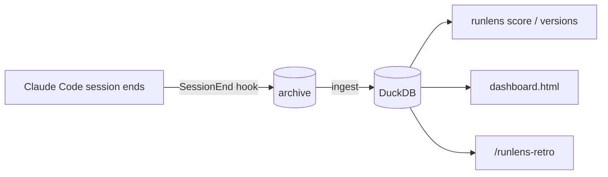

**What it is not.** runlens is observational: your tasks differ from run to run, so it cannot prove that an edit *caused* a change. It finds *where* a flow struggles and whether a new version's runs look different; to prove an edit helped, re-run the exported failures on a fixed benchmark.

## Quick start

```bash
uv tool install git+https://github.com/marcossp32/runlens.git
runlens install      # the SessionEnd hook, the /runlens-retro skill and a starter config
runlens refresh      # archive and load the runs you already have
runlens check        # the data is complete and the parser kept up
runlens score        # each skill's current version against its previous one
runlens dashboard    # prints the path of dashboard.html: open it in a browser
```

A **run** is one Claude Code session plus every subagent it spawned. runlens knows nothing about any particular flow: skills, agent types and roles are read from the transcripts, and everything flow-specific (which sessions count, which output lines are signals, what a success looks like) lives in `~/.runlens/config.toml`.

## A tour of the dashboard

`runlens dashboard` writes `~/.runlens/dashboard.html` (`--out` to choose the path): one static page with the data embedded. It opens offline from any folder, needs no server and makes no network requests. The hook rebuilds it after it ingests runs unless `[dashboard] auto = false`; after a manual `runlens refresh`, run `runlens dashboard`.

Every page starts with its answer in a sentence, worked out from your data, then a few key numbers, then charts grouped under headings. Each chart is titled with the question it answers and a one-line takeaway, and keeps its encodings and caveats under "How to read this".

### Did my last edit help?

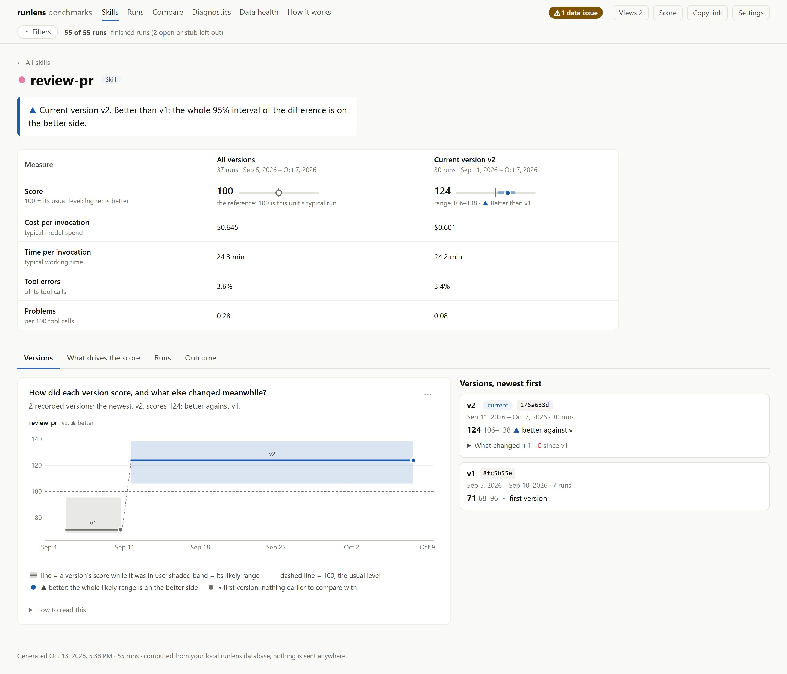

**One skill, agent role or group.** Its versions on a real time axis with their likely range, the verdict of each against the one before, the diff of its text, a waterfall of what moves its score, the outcome over time, and every run.

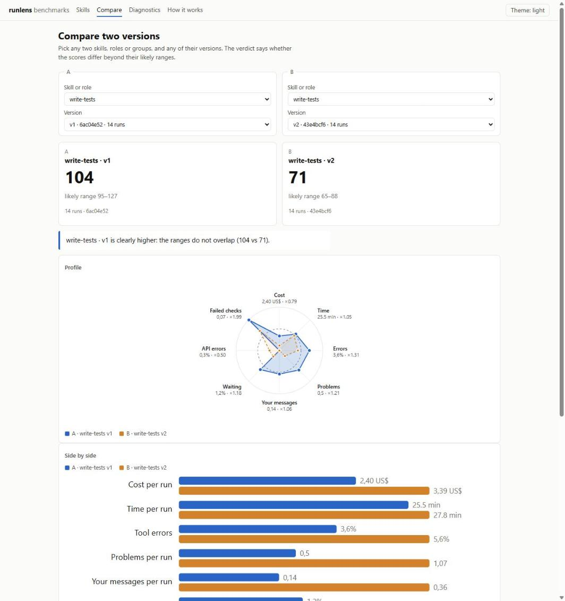

**Compare.** Any two versions of a skill or group: the verdict, what else changed between them, and how much better or worse each measure is, with its interval.

### What happened in this run?

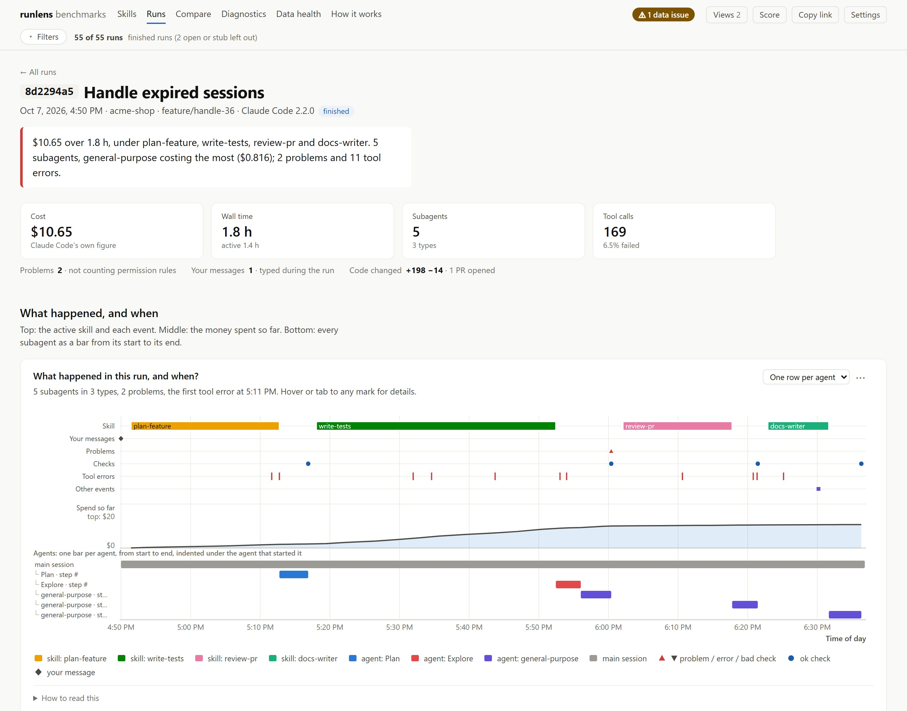

**One run.** The whole session on one time axis, with every subagent nested under the one that started it; its cost by agent, model, token type and skill; and copyable `runlens show` / `runlens sql` commands for the raw data.

### More views

<table>
  <tr>
    <td width="50%" valign="top"><a href="docs/images/skills-cost.jpg">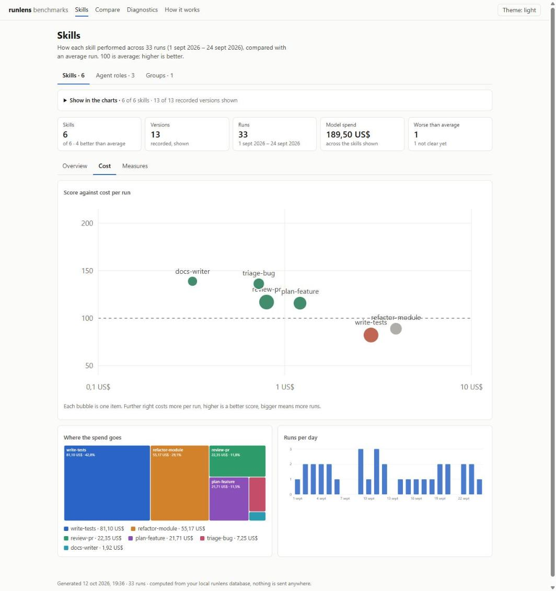</a><br><b>Cost.</b> Which skills reach their outcome for the least money, where the money goes over time, and whether you pay for input, cache or output.</td>
    <td width="50%" valign="top"><a href="docs/images/diagnostics.jpg">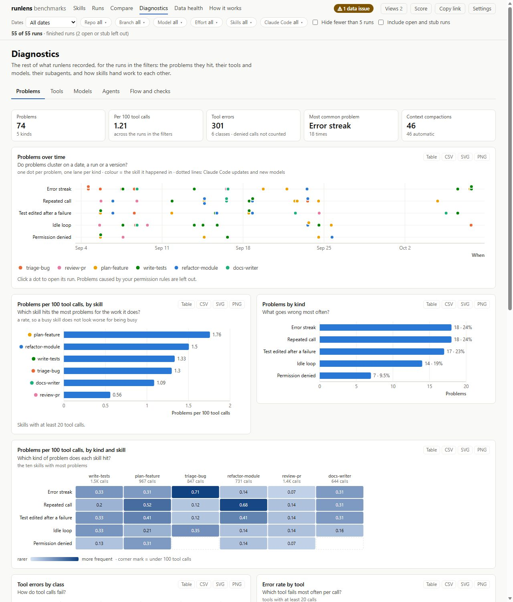</a><br><b>Diagnostics.</b> Problems and tool errors over time and per skill, tools, models and effort, subagents, skill hand-offs and checks.</td>
  </tr>
  <tr>
    <td width="50%" valign="top"><a href="docs/images/groups.jpg">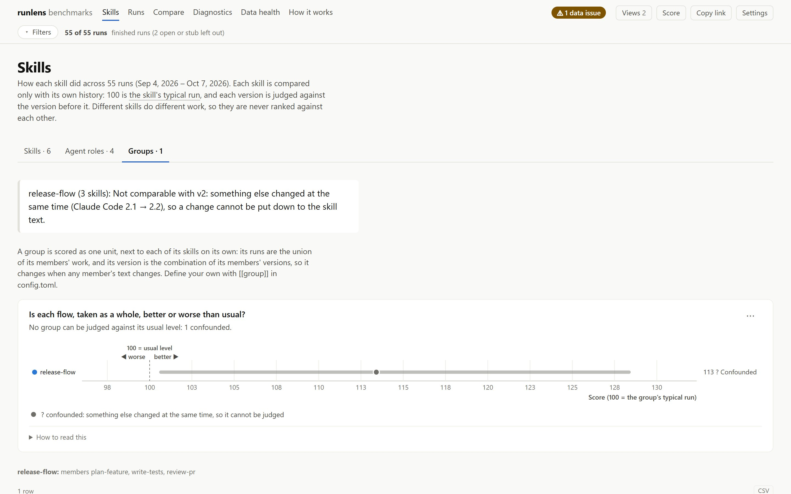</a><br><b>Groups.</b> Skills used and edited together, found in your runs or defined in config, scored as one unit next to each skill on its own.</td>
    <td width="50%" valign="top"><a href="docs/images/runs.jpg">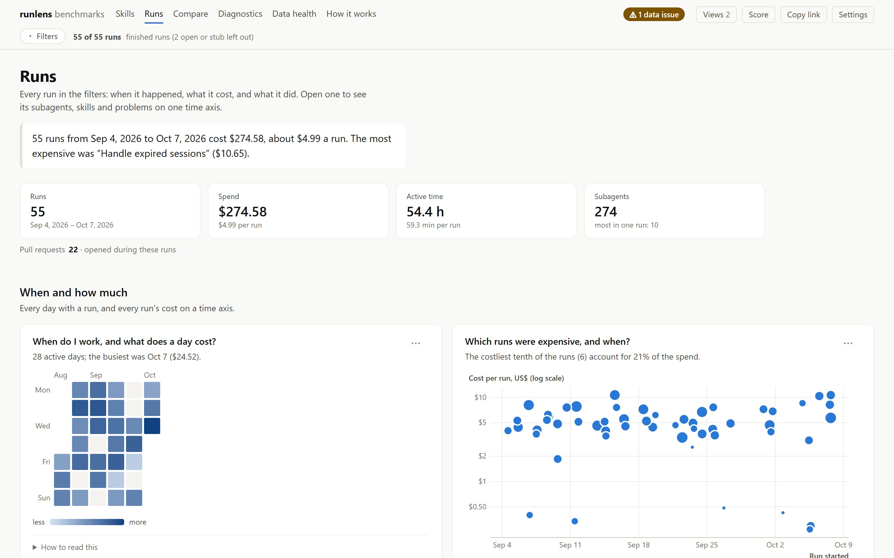</a><br><b>Runs.</b> When you work, what a day costs, and which runs were expensive.</td>
  </tr>
  <tr>
    <td width="50%" valign="top"><a href="docs/images/score-panel.jpg">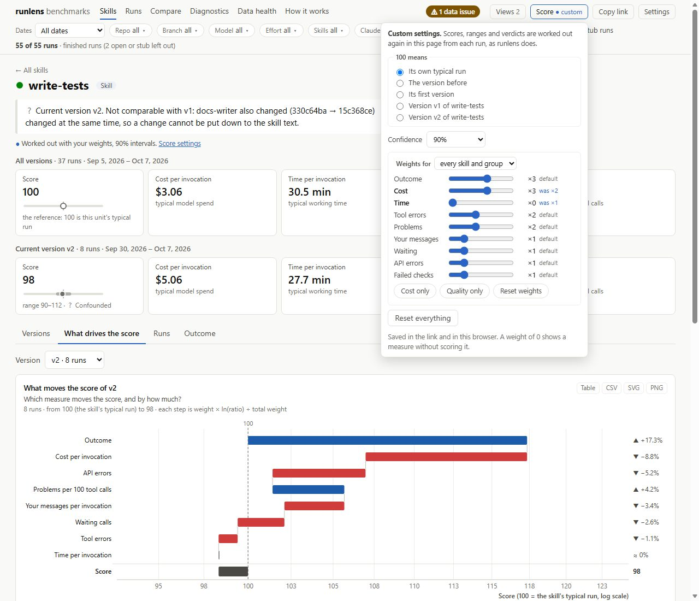</a><br><b>Score settings.</b> What 100 means, the weight of each measure and the confidence level. The page re-runs the method in place and marks the result "custom".</td>
    <td width="50%" valign="top"><a href="docs/images/data-health.jpg">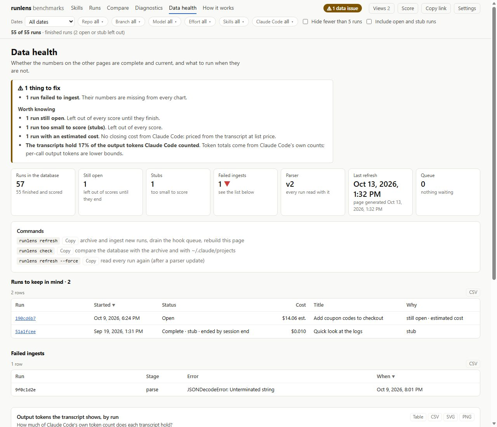</a><br><b>Data health.</b> Open and stub runs, failed ingests, unpriced models and token coverage, each with the command that fixes it.</td>
  </tr>
  <tr>
    <td colspan="2" valign="top"><a href="docs/images/how-it-works.jpg">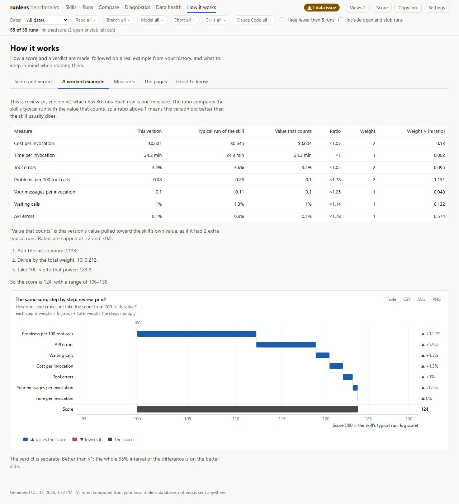</a><br><b>How it works.</b> The method in plain words, with a worked example on one of your own skills.</td>
  </tr>
</table>

**Filters, links and views.** A "Filters" button narrows every page to some dates, repos, branches, models, effort levels, skills or Claude Code versions; active filters show as chips and the count of runs left is always on screen. The page state is in the URL, so a link reproduces a view. **Views** keeps named views in the browser, and `[[dashboard.view]]` tables in config.toml (a `name` and a `hash`, the part of a dashboard link after `#`) add shared ones. Each chart's "⋯" menu shows its data as a table and downloads it as CSV, SVG or PNG.

> [!WARNING]
> **The dashboard contains transcript text**: each skill version's text, run arguments and task titles. Keep it on your machine and check it before you share it.

## Install

| Requirement | Why |
|---|---|
| [uv](https://docs.astral.sh/uv/getting-started/installation/) | Installs runlens and fetches Python 3.11+ if you don't have it |
| [Claude Code](https://code.claude.com/docs/en/setup) | runlens reads the transcripts it writes to `~/.claude/projects` |
| `claude` on the PATH | Only for `runlens classify` (it runs `claude -p` with your login, no API key) |
| git | Only if an `[[evidence]]` rule uses `{git_dir}` |

Works on Windows, macOS and Linux. Do this on every machine where you run Claude Code.

1. **Install the tool:** `uv tool install git+https://github.com/marcossp32/runlens.git`. If `runlens` is not found afterwards, run `uv tool update-shell` and open a new terminal.
2. **Hook it into Claude Code:** `runlens install`. Safe to run again. It:
   - adds a `SessionEnd` hook to `~/.claude/settings.json` (backed up first to `settings.json.runlens-backup-<date>`);
   - copies the `/runlens-retro` skill into `~/.claude/skills`;
   - writes `~/.runlens/config.toml` from [`config.example.toml`](runlens/config.example.toml) if there is none.
3. **Say which runs to record** under `[select]` in `~/.runlens/config.toml` (default: every session).
4. **Load what you already have:** `runlens refresh`, then `runlens check`.

**How the hook works.** When a session ends, the hook only writes `~/.runlens/pending/<session_id>`, logs one line to `~/.runlens/hooks.log`, starts a detached `runlens drain` and returns, well under a second. It is synchronous with a 10 s timeout, because an async hook can be killed when a `claude -p` session tears down (we saw it die before queuing anything). The detached drain archives and ingests the queued runs and rebuilds the dashboard. If a drain never ran (the machine slept, the process was killed), `runlens refresh` processes the queue first.

**Keep Claude Code's transcripts longer (optional).** Claude Code deletes transcripts after `cleanupPeriodDays` (30 by default). The runlens archive keeps its own copy, so this only matters for `/resume` or for `runlens refresh` to reach further back: set `{ "cleanupPeriodDays": 90 }` in `~/.claude/settings.json`.

**Good to know.**
- Each machine records only its own sessions. To bring another machine's history over, copy its `~/.runlens/archive/` and run `runlens ingest`.
- The hook calls the tool's own Python by absolute path. `uv tool upgrade` keeps that path; after `uv tool uninstall` and a fresh install, run `runlens install` again.

**Update.**

```bash
uv tool upgrade runlens
runlens install           # refreshes the /runlens-retro skill
runlens refresh           # runs parsed by an older parser are parsed again automatically
runlens migrate-evidence  # once, if you used [[evidence]] with runlens 0.1 (dry run; add --yes)
```

## Improve a skill, step by step

The loop is *find a weak spot → trace it to the skill text → edit → verify*. `/runlens-retro` in Claude Code does steps 1 to 4 and the production half of step 6 for you: it reports how earlier proposals did, traces today's failures to the skill text, and records its proposals. It decides how to investigate; the commands below are what it has to work with. Add `label` to its arguments to let it spend `claude -p` calls on labelling.

1. **Refresh and check.** `runlens refresh`, then `runlens check`. A `FAIL` line means the numbers are wrong (stop and fix it first); `WARN` lines name gaps such as runs archived but not ingested, queued by the hook, or changed since they were archived. Runs still open show as `ok … open:`.
2. **Find where to look.** `runlens score` lists every skill's current version against its previous one. `runlens versions <skill>` shows all versions of one skill: runs, invocations, outcome, the verdict against the version before, its confounders, and the diff. Look first at versions whose verdict is `worse`, then at skills with a low or falling outcome, then at the ones with the most incidents.
3. **Read the evidence.** `runlens incidents --skill <skill>` lists what went wrong; `runlens show <id>` prints the timeline around one incident. `runlens classify --skill <skill>` labels incidents with a failure taxonomy (the judge sees the skill text that was active, so it can quote the instruction at fault). A failure mode needs two or more incidents; one is an anecdote.
4. **Record a proposal before editing.** `runlens proposals add --skill <skill> --hypothesis "..." --measure error_rate --direction lower --evidence <ids>` stores the hypothesis against the version you are about to edit.
5. **Edit the skill.** The next run that loads it records a new version (a hash of its text).
6. **Verify.** Two ways, best used together:
   - **Fast and causal:** `runlens export-eval --incident <id> ...` writes the real failures as eval cases. Run them with `claude plugin eval` (the export's README has the exact command) or merge them into the skill's skill-creator evals, once with the old text and once with the new. Same tasks, repeated runs: this is what can show the edit itself helped.
   - **Slow and in production:** after the new version has at least 5 finished runs, `runlens verify` compares them with the base version's runs and marks the proposal `confirmed`, `refuted` (it moved the other way, beyond noise), `inconclusive` (no clear change), `not enough runs` or `confounded`.

**How many runs you need.** A verdict needs at least `[method] min_runs` (default 5) finished, non-stub runs on *each* side. Runs are resampled by session, so five sessions are five data points however many times the skill was invoked in them. With five runs a side, only large changes clear the interval; a 10–20% change usually needs many more runs than you will have. In a simulation on real rows, halving the cost alone gave a `better` verdict about 5% of the time with 5 runs a side and 7% with 10, and scaling every measure by 0.5 gave it 25% and 37% (0.67: 3% and 14%): cost is only 2 of about 14 weight units, its contribution is clipped at a factor of 2, and the noise of the other measures enters in full. So `no clear change` is the usual outcome, and it is not evidence that an edit did nothing. For an edit aimed at one measure, record it in the proposal (`--measure`): `verify` then judges that measure on its own interval, which is the declared primary metric. That is why the eval benchmark is the faster check and the production verdict is the confirmation.

**Editing several skills at once makes verdicts "confounded".** If you edit `plan` and `build` together, every run of the new `build` also has the new `plan`, so `build`'s verdict cannot be put down to its own text: runlens says `confounded` and names `plan also changed (a1b2 → c3d4)`. Either edit one skill at a time, or judge the skills you edit together as one set. runlens finds such sets on its own: skills used together in most of their runs and edited at the same time become a group named after their common prefix (`m-* set`), next to each skill on its own. You can also define a `[[group]]` yourself. A group's version is the combination of its members' versions, so it changes when any member's text changes, and its verdict is not confounded by its own members: the group is the level at which a batch edit can be judged. In **Compare** you can pick any two of its versions, not only consecutive ones.

## The method

The question runlens answers is *did a change to this skill make its runs better or worse?* So every comparison stays inside one skill (or one group).

- **Population.** Only finished runs count (`status = 'complete'`: the session ended, or no new records for `[runs] idle_hours`), and stub runs (fewer than 3 model turns or under $0.02) are left out.
- **Measures.** Rates are ratios of sums over runs (events over opportunities), so a big run weighs as much as its size. Cost and time are geometric means per invocation (a skill load, a subagent spawn or a group run), because a tenth of the runs carry most of the spend.

  | Measure | Weight | What it is |
  |---|---|---|
  | `outcome` | 3 | The result the flow is meant to reach, from `[outcome]`: a check's first-pass rate, or a PR opened. Only with an outcome configured |
  | `cost` | 2 | Model spend per invocation |
  | `seconds` | 1 | Working time per invocation (each model turn to the same agent's next, capped at 10 minutes) |
  | `error_rate` | 2 | Failing tool calls over tool calls. Calls a permission rule denied are not errors |
  | `incidents` | 2 | Scored problems per 100 tool calls. Not counted: policy denials, failed checks, idle loops and error streaks (other measures count them) and incidents labelled expected behaviour |
  | `interventions` | 1 | Human prompts per invocation (skills and groups only). Set it to 0 for skills meant to ask |
  | `idle_rate` | 1 | Tool calls that only wait or print |
  | `api_error_rate` | 1 | Model turns with an API error. Quota and rate limits are not errors |
  | `bad_markers` | 1 | Config markers with a bad value, per invocation (a marker used as the outcome counts there instead) |

  Change weights under `[weights]`, globally or per skill or group.
- **Score.** 100 is the skill's own typical run. For each measure, ℓ = ln(reference / value), clipped to a factor of 2 either way; the score is 100 × exp(Σ w·ℓ / Σ w). A version's value is pulled slightly toward its own skill's value (2 pseudo-runs), never toward other skills. Scores of different skills are shown side by side but never ranked: research is cheaper than building, and that says nothing about either skill.
- **Verdict.** Version B against version A comes from a bootstrap of the *difference*: each side's runs are resampled by session (10,000 times), the weighted difference is recomputed each time, and its central 95% interval (expanded percentile, for small samples) decides: entirely above zero is `better`, entirely below is `worse`, otherwise `no clear change`. `no clear change` means the interval holds zero; it is not evidence that the versions are alike (that would need an equivalence test against a declared margin, which runlens does not do). Fewer than 5 runs on a side is `not enough runs`, with no interval; enough runs but every weight at 0 is `not scored`. A version is a hash over a contiguous stretch of runs, so reverting a skill (A, then B, then A) gives three versions, and the newest is the current one. In bootstrap draws a measure with no data counts as no change instead of dropping out, so the weights are not renormalised from draw to draw. A score shown against the skill's typical run ("above" or "below" it) is descriptive, not a verdict: the typical run includes the version's own runs. Verdict limits, stated plainly:
  - *Power is low* (see "How many runs you need"). No primary-metric, Bayesian or equivalence machinery is built in; `verify` with `--measure` is the nearest thing.
  - *Peeking.* The verdict is recomputed with the runs so far on every refresh, so looking after each run calls a change more often than 5% (in a null simulation, 14% of the time at some look, 8% at the final one). runlens does not use anytime-valid intervals; decide a number of runs per version in advance and read the verdict then.
  - *Multiplicity.* Each listed unit is one of many tests, so the model gives it a Benjamini-Hochberg q over all units compared (`p_adjusted` in `runlens score --json`), and the dashboard says when a `better` or `worse` does not survive it. Per-measure intervals in Compare are exploratory and not adjusted.
  - *Monte Carlo error.* The ends of an interval rest on a few draws with five runs a side, hence 10,000 resamples by default. The dashboard recomputes with at most 4,000 (it works in the page, so it trades precision for speed) and its own generator, so a recomputed interval can differ from the model's by several points at small samples.
- **Confounders.** When something else changed between the two sides, the verdict is `confounded` and names it: another skill's text changed in the same runs, the model (full id, so haiku-4-5 → haiku-5-5 counts) or effort mix of the main agent shifted, the Claude Code version changed (down to the patch release, or only the minor with `cc_version = "minor"`), or the project mix changed. A mix counts as shifted when its total variation distance reaches 0.3, or more when there are few runs (1.5 / √runs on the smaller side), so chance alone rarely trips it. The raw direction is kept, but the change cannot be put down to the skill text.
- **Outcome.** Without an `[outcome]`, the score measures cost and friction only, and a cheaper skill that does less would look better. Configure one: a marker's first-pass rate (a chain of checks counts as one attempt, a success at the first check is a first-pass success) or `pr = "opened"`. The dashboard also shows cost per success.

**What the score does not tell you.**
- Whether the work was right, beyond the outcome you configured. Read the traces before acting on a drop.
- Anything about one skill compared with another.
- That an edit *caused* a change: tasks differ between runs. Use the eval export for that.
- Work a subagent did before it loaded a skill: that part is inherited from the skill that spawned it. A skill that a subagent loads gets its own unit and versions, and the subagent's later work is credited to it.

## CLI reference

Every command accepts `--config <file>` before the command name (default `~/.runlens/config.toml`). Errors a user can fix (bad config, bad SQL, database busy) print one line and exit 1.

**Data**

| Command | What it does | Flags |
|---|---|---|
| `archive` | Copy selected runs from `~/.claude/projects` into the archive. A run whose source changed is copied again | `--since DATE`, `--skill NAME`, `--project TEXT`, `--session ID` (the last three repeatable), `--quiet` |
| `ingest` | Load the archive into DuckDB. Incremental: unchanged runs are skipped (see [Data](#data-reference)) | as `archive`, plus `--force` (parse every run again) |
| `refresh` | Drain the hook's queue, then `archive` + `ingest` | as `ingest` |
| `check` | Compare the database with the archive and the archive with `~/.claude/projects`, and warn when the installed `/runlens-retro` is older than this runlens's; exits 1 on any `FAIL` or `WARN` | `--session ID` (repeatable), `--no-sources` (skip the comparison with `~/.claude/projects`) |
| `prune` | Delete runs from the database and the archive. Lists them unless `--yes` | `--before DATE`, `--session ID` (or 8-char prefix, repeatable), `--keep-archive` (database rows only), `--yes` |
| `migrate-evidence` | Convert evidence archived by runlens 0.1 into deduplicated blobs and delete the old folders. Dry run unless `--yes` | `--yes`, `--keep-excluded` (also keep browser profiles, databases, node_modules) |
| `sql "<query>"` | Any read-only query over the tables and views | `--json`, `--csv` |

**Method**

| Command | What it does | Flags |
|---|---|---|
| `score` | Each unit's current version against its previous one: runs, invocations, verdict, difference, outcome, typical cost | `--kind skill\|agent\|group` (default `skill`), `--json` |
| `versions <skill>` | Every version of a skill (or a unit id such as `group:my-flow`): runs, invocations, score, verdict, confounders, outcome, cost per success, the diff against the previous version, and the folders the skill was loaded from | `--json` |
| `proposals add` | Record a proposed edit; prints its id (`p-0001`, ...) | `--skill` (required), `--hypothesis` (required), `--measure` (required: `score` or a measure key), `--direction lower\|higher` (required), `--evidence ID ...`, `--base-version HASH` (default: the current version) |
| `proposals list` | List recorded proposals | `--json` |
| `verify [<id>]` | Check one or every proposal against the runs since: `confirmed`, `refuted`, `inconclusive`, `not enough runs`, `confounded` | `--json` |

**Diagnosis**

| Command | What it does | Flags |
|---|---|---|
| `incidents` | List incidents with their latest label (a human one before an LLM one); `--json` and `--csv` add the quoted instruction and the skill hash the judge saw. Permission denials caused by your permission rules are hidden unless `--all` | `--type`, `--skill`, `--limit N` (50), `--all`, `--json`, `--csv` |
| `show <id>` | The timeline around an incident or tool call: what the agent was asked, said and did | `--steps N` (12 before), `--after N` (4) |
| `classify` | Label incidents with the failure taxonomy through `claude -p`. Prints its cost | `--type` (repeatable), `--skill` (repeatable), `--limit N` (20), `--model ALIAS`, `--workers N` (4), `--relabel`, `--sample stratified\|priority`, `--seed N`, `--dry-run` (print one prompt, no model call) |
| `labels export\|import <csv>` | Human review of the labels | export: `--limit N` (stratified sample), `--seed N`, `--blind` (leave the LLM labels out) |
| `agreement` | LLM labels against human ones: Cohen's kappa, TPR/TNR per category, which categories are verified | `--json` |
| `export-eval` | Turn real incidents into eval cases for `claude plugin eval` and skill-creator, with a README saying what is and is not reconstructed | `--incident`, `--skill`, `--label`, `--type` (all repeatable), `--format plugin-eval\|skill-creator\|both`, `--out DIR`, `--limit N` (10), `--history` (resume the main transcript just before the failing step) |
| `summary` | One table per run and one per skill, in the terminal | |
| `report` | A self-contained HTML diagnosis report | `--out FILE`, `--session ID` (repeatable) |
| `dashboard` | The benchmark dashboard | `--out FILE` |

**Setup:** `install [--no-skill]`, `uninstall` (removes only the runlens hook), `hook` (the hook's entry point, reads the hook JSON on stdin).

**Environment:** `RUNLENS_HOME` (default `~/.runlens`), `CLAUDE_CONFIG_DIR` (default `~/.claude`; Claude Code's own setting, which moves the paths below and the installed skill), `CLAUDE_PROJECTS` (default `$CLAUDE_CONFIG_DIR/projects`), `CLAUDE_SETTINGS` (default `$CLAUDE_CONFIG_DIR/settings.json`).

## Config reference

Every section is optional. [`config.example.toml`](runlens/config.example.toml) documents every key with its default. A value runlens cannot use stops the command with a one-line error naming the key.

| Section | Keys (default) | What it sets |
|---|---|---|
| `[select]` | `since` (""), `skills` ([]), `projects` ([]) | Which sessions are runs. CLI filters override it |
| `[runs]` | `idle_hours` (12), `stub_api_calls` (3), `stub_cost_usd` (0.02) | When a run without a closing record counts as finished, and when a run is too small to benchmark |
| `[privacy]` | `redact` (false), `patterns` ([]) | Mask secrets, tokens and e-mails before text reaches DuckDB; extra regexes |
| `[analysis]` | `repeat_min` (3), `repeat_window_s` (600), `idle_min` (3), `error_streak_min` (2), `context_steps` (8), `test_path`, `idle_parts` | Thresholds and patterns of the generic incident detectors |
| `[classify]` | `model` ("sonnet"), `before` (12), `after` (4), `skill_chars` (14000), `timeline_chars` (9000) | The judge's model and how much timeline and skill text it sees |
| `[[evidence]]` | `name`, `glob`, `scope` ("run"), `slack_minutes` (10), `max_mb` (200), `exclude` ([]) | Extra files to keep with each run. Placeholders `{cwd}`, `{git_dir}`, `{session_id}` |
| `[[marker]]` | `name`, `pattern`, `source` ("any"), `bad` ([]) | Output lines that are signals; a bad value becomes an incident |
| `[outcome]` / `[[outcome]]` | `marker` + `success` + `failure` (the marker's bad values), or `pr = "opened"`; `skills` ([] = all); `name` | What a successful run looks like |
| `[weights]`, `[weights.<skill or group>]` | measure = weight (see [the method](#the-method)) | Weight of each measure; 0 = shown, not scored |
| `[method]` | `min_runs` (5), `resamples` (10000), `confidence` (0.95), `cc_version` ("patch"), `auto_groups` (true) | How verdicts are made, and whether sets of skills used and edited together are scored too |
| `[[group]]` | `name`, `members` (`"skill:<name>"` or `"agent:<type>"`) | Skills and agent types scored as one unit, besides the sets found in the runs (`[method] auto_groups`, on by default) |
| `[prices]` | `"<model>" = [input, output, cache_read]` (USD per million tokens) | Prices for models missing from the built-in table |
| `[dashboard]`, `[[dashboard.view]]` | `auto` (true); a view's `name` and `hash` | Rebuild the dashboard after the hook ingests runs; named links into the page, offered as starting points |

To adapt the failure taxonomy, copy [`taxonomy.toml`](runlens/taxonomy.toml) to `~/.runlens/taxonomy.toml`.

## Data reference

Everything is in `~/.runlens/runlens.duckdb`; query it with `runlens sql`. The schema migrates itself when runlens is upgraded. `ingest` parses a run again when its archived transcript, the parser, or the config sections that shape its rows (`[[marker]]`, `[analysis]`, `[prices]`, `[runs]`, `[privacy]`) changed; anything else is skipped.

| Table | One row per |
|---|---|
| `runs` | run: repo, branch, Claude Code version, cost, active time, `status` (complete/open), `is_stub`, `pr_urls`, `unpriced_models` |
| `agents` | agent (`main` and each subagent): type, role, spawn prompt, parent, final status, tokens, peak context, effort, `stopped_by_user` |
| `api_calls` | API call: model, effort, skill, tokens, cost, API errors (`api_limit` marks quota and rate limits, which are not errors) |
| `tool_calls` | tool call: tool, skill, input, duration, error and class, exit code, denial and permission decision, patch size, idle wait |
| `texts` | the agent's visible text between tool calls |
| `events` | human prompts, interrupts, compactions, API errors and limits, re-injected skills |
| `markers` | matches of the `[[marker]]` patterns |
| `skill_loads` | each skill load, with the hash of its text (its version) and the arguments |
| `skill_texts` | each skill version's text, once: what version diffs compare |
| `skill_mentions` | a skill offered to an agent, and whether it was then loaded |
| `compactions` | each real compaction: trigger, tokens before and after |
| `model_usage` | Claude Code's own per-model token and cost totals for the run (from its cost-state) |
| `incidents` | moments worth reading, each with the timeline that led to it |
| `labels` | failure labels from the LLM and from humans; they survive re-ingest |
| `proposals` | proposed skill edits and their verification; they survive re-ingest |
| `ingest_state`, `ingest_errors`, `meta` | what was ingested by which parser, what failed, schema and parser version |

Views (in [`views.sql`](runlens/views.sql)): `v_runs`, `v_skill`, `v_role`, `v_model`, `v_tools`, `v_tool_errors`, `v_idle`, `v_markers`, `v_skill_flow`, `v_skill_versions`, `v_skill_version_stats`, `v_incident_summary`, `v_labels`, `v_label_summary`, `v_token_coverage`, `v_api_errors`, `v_skill_mentions`, `v_compactions`, `v_data_health`.

**How some numbers are read.**
- **Cost** comes from Claude Code's cost-state per model, split across that model's calls by list price. A run with no cost-state yet is estimated at list price (`cost_estimated`). A model with no known price gets no cost and is named by `runlens check`; add it under `[prices]`.
- **Tokens.** In the runs we measured, transcripts held only about 10–24% of the output tokens Claude Code counts (see `v_token_coverage`), and most calls have no final usage record, so token totals come from `model_usage` (cost-state). Per-call output and thinking tokens are lower bounds.
- **Skill attribution.** A skill load pushes the skill onto its agent's stack, an explicit attribution wins, and the end of a nested skill pops back to the outer one. Fork agents' copied history is skipped, so nothing is counted twice.
- **Versions.** A version is a hash of the skill text as Claude Code injected it, without the arguments. Files a skill reads later (references, scripts) are not part of it.

## Privacy and retention

- **Everything is local.** The archive, database, dashboard and report live in `~/.runlens/`. Nothing is sent anywhere, except incident timelines and skill text to `claude -p` when you run `classify`.
- **Redaction.** `[privacy] redact = true` masks API keys and tokens (Anthropic, OpenAI, GitHub, GitLab, Slack, AWS, Google, Stripe, npm), private keys, JWTs, bearer tokens, passwords in URLs and assignments, and e-mail addresses in the stored text columns (tool inputs and outputs, agent text, prompts, skill texts, event details, marker values), and in the task prompt and history that `export-eval` writes; the working directory, git branch and PR links are not masked. Text is masked before it is cut to its stored length. Add your own regexes in `patterns`. Hashes are taken before masking, so counts do not change. The archived transcripts stay verbatim, because they are what runlens re-ingests from.
- **Retention.** `runlens prune --before 2026-01-01` (or `--session <id>`) lists the runs it would delete; add `--yes` to delete their database rows and archived files. `--keep-archive` deletes only the rows.
- **Evidence.** `[[evidence]]` files are stored once by content hash under `archive/_blobs`. By default only files modified during the run are kept, at most `max_mb` per run and rule, and browser profiles (cookies, saved passwords, local storage), databases, `node_modules`, `.git` objects and virtualenvs are never kept. Add your own `exclude` globs.

## Troubleshooting

| You see | Why, and what to do |
|---|---|
| `runlens check` prints `FAIL` | The parser fell behind the transcript format, an ingest failed, or evidence blobs are missing. Don't trust the numbers until it passes |
| `WARN ... open` or `queued by the hook` | A session is still running, or its drain has not run. `runlens refresh`; open runs are left out of verdicts until they finish (or go `idle_hours` without new records) |
| `WARN ... source changed since it was archived` | A session kept going after it was archived. `runlens refresh` copies and parses it again |
| `the database is in use by another runlens process` | DuckDB allows one writer at a time; a drain or another command holds it. Commands wait 30 s; try again a moment later |
| `no price for <model>` | Add the model under `[prices]`; its calls have no list-price cost until then |
| Token totals don't match the transcript | Expected: see **Tokens** in the [data reference](#data-reference). Use `model_usage` or `v_token_coverage` |
| A skill is missing from `score` | It may not match `[select]`, have no finished non-stub runs, or has no finished non-stub run once subagent work before the load is left out |
| A verdict says `not enough runs` or `confounded` | See [how many runs you need](#improve-a-skill-step-by-step) and why batch edits are confounded |
| The dashboard is out of date | `runlens dashboard` rebuilds it. Hook and drain errors are in `~/.runlens/hooks.log` |
| Deleting `~/.runlens` fails on Windows | Archived paths can exceed 260 characters. Use the long-path form (see [Uninstall](#uninstall)) |

## Uninstall

```bash
runlens uninstall                    # removes only the runlens hook from ~/.claude/settings.json
uv tool uninstall runlens
rm -rf ~/.claude/skills/runlens-retro
rm -rf ~/.runlens                    # only if you also want to delete the recorded history
```

On Windows, archived paths can be longer than 260 characters, and a plain delete fails with "path too long" or "directory not empty". Use the long-path prefix:

```bat
rd /s /q "\\?\%USERPROFILE%\.runlens"
```

## Development

```bash
git clone https://github.com/marcossp32/runlens.git
cd runlens
uv sync                                       # .venv with the locked dependencies
uv run python -m unittest discover -s tests   # the test suite
uvx ruff@0.17.0 check                                # lint
uv tool install -e .                          # a `runlens` command that runs this checkout
```

Dependencies are locked in `uv.lock`; after changing `pyproject.toml`, run `uv lock`. CI runs the suite with Python 3.11 and 3.14 on Linux and 3.14 on Windows and macOS, lints with ruff, checks the dashboard script with `node --check`, renders every dashboard page in headless Chrome (Linux only), and smoke-tests the built wheel. The browser tests look for Chrome, Chromium or Edge and are skipped without one; `RUNLENS_BROWSER` points them at a specific binary.

### Screenshots

The images in this README come from `scripts/make_demo.py`, which builds an invented history in a throwaway folder; it never reads your transcripts. They are taken at 1440 px wide and twice the pixel density, in en-US number format. To see the same data:

```bash
uv run python scripts/make_demo.py demo-home
RUNLENS_HOME=demo-home uv run runlens dashboard --out demo.html
```

## References

- Cemri et al., [Why Do Multi-Agent LLM Systems Fail?](https://arxiv.org/abs/2503.13657) (MAST), NeurIPS 2025: the failure taxonomy seed.
- [SWE-PRM](https://arxiv.org/abs/2509.02360) and [ImpossibleBench](https://arxiv.org/abs/2510.20270): coding-agent failure modes and test tampering.
- [TRAIL](https://arxiv.org/abs/2505.08638): why trace judges must be validated.
- Hesterberg, [What Teachers Should Know About the Bootstrap](https://arxiv.org/abs/1411.5279): the expanded percentile interval for small samples.
- Hamel Husain and Shreya Shankar, [AI Evals: Everything You Need to Know](https://hamel.dev/blog/posts/evals-faq/): error analysis, binary judges, judge alignment.
- Anthropic, [Demystifying evals for AI agents](https://www.anthropic.com/engineering/demystifying-evals-for-ai-agents).
- Claude Code docs: [hooks](https://code.claude.com/docs/en/hooks), [plugin evals](https://code.claude.com/docs/en/plugin-evals), [skills](https://code.claude.com/docs/en/skills).

## License

[MIT](LICENSE)
